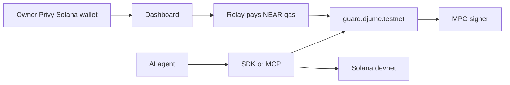
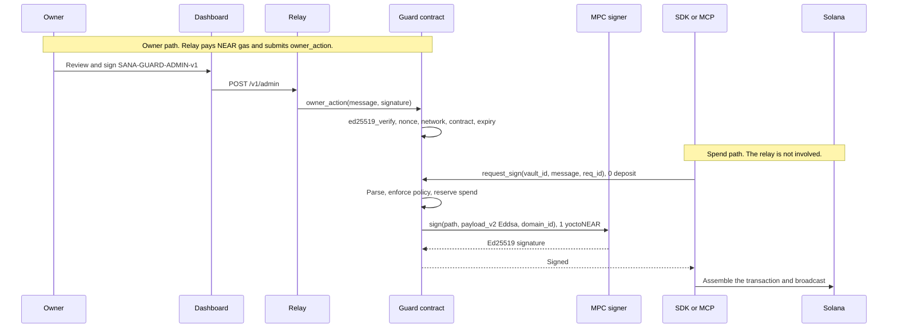

# Sana Guard

**A policy-enforced agent wallet.** A NEAR contract holds per-vault policy and uses NEAR Chain Signatures (MPC, Ed25519) to sign arbitrary Solana transactions for AI agents only when those transactions pass policy.

The agent never holds the Solana private key. The key stays inside NEAR's MPC signer. The guard contract (`guard.djume.testnet`) parses the Solana message and calls `sign` on the MPC contract only after the vault's rules accept it. Owners set those rules with a Privy embedded Solana wallet. A relay pays the NEAR gas for owner actions. Agents call `request_sign` themselves, through `@sana-guard/sdk` or the MCP server.

NEAR Hackathon, **1–15 Nov 2026**, track **AI Security & Defense**. This submission is NEAR **testnet** and Solana **devnet**. The form notes in [`docs/SUBMISSION.md`](./docs/SUBMISSION.md) use a deadline of **14 Nov 2026, 23:59 WIB**.

**Demo video:** `<VIDEO_URL>` — recording script in [`docs/DEMO.md`](./docs/DEMO.md).

## Live

| What | Where |
| --- | --- |
| Dashboard | https://guard.sana.bot |
| Vault 0 (public policy, balance, recipients, Attack lab) | https://guard.sana.bot/vaults/0 |
| Relay health | https://relay-production-665a.up.railway.app/v1/health |
| Guard contract | [`guard.djume.testnet`](https://testnet.nearblocks.io/address/guard.djume.testnet) |
| Vault 0 Solana address (devnet) | [`Fkk515Q2ZKeg3aqkcpSwVvFbDVj8VVDesHwWttbtMbgU`](https://explorer.solana.com/address/Fkk515Q2ZKeg3aqkcpSwVvFbDVj8VVDesHwWttbtMbgU?cluster=devnet) |
| Recorded signed devnet transfer | [explorer](https://explorer.solana.com/tx/5w6yEG25bVffWMFERM4LF9oJVmtGutZqbC1WrA7bx43UWvEJcCeFueU9xDaYkNrLuRrVkySSjQZcm5FsuBY1CX1r?cluster=devnet) (5000 lamports, vault `Fkk515…` → `DeF8…`, linked from [`docs/DEMO.md`](./docs/DEMO.md)) |
| Demo video | `<VIDEO_URL>` |

Vault 0 loads without a Privy session. The page shows policy, balance, recipients, and the Attack lab. Pause and policy edits appear only when the signed-in Privy wallet is that vault's owner. The hosted Attack lab is enabled for vault 0 (`GET /api/attack-lab`). Running it needs the server-side `ATTACK_LAB_TOKEN` (name only; never commit the value). Self-hosting the lab also needs `DEMO_AGENT_ACCOUNT_ID`, `DEMO_AGENT_PRIVATE_KEY`, and `DEMO_AGENT_VAULT_ID`.

On **4 Nov 2026**, `version()` on `guard.djume.testnet` returned `0.1.0` / git `9cb56bd5c761`, and `GET /v1/health` returned `network: testnet`, `guardContract: guard.djume.testnet`, status healthy, balance floor `0.5` NEAR. The same read of `get_vault(0)` is in [Vault 0](#vault-0-on-testnet) below.

## The problem

An agent that holds a raw Solana key is a hot wallet with an LLM in front of it. A leaked key, a prompt injection, or a jailbroken tool call can send the whole balance. A sentence in the prompt ("don't send more than X") is not enforcement: the model can ignore it, and the chain never sees it.

Sana Guard removes that key. Spending policy lives in a NEAR contract the agent cannot edit. The only signature over the vault's Solana funds is an Ed25519 signature from NEAR Chain Signatures, and the contract asks for that signature only after the parsed message passes policy. A leaked agent function-call key can still call `request_sign`. It cannot raise a limit, add a recipient, or obtain the MPC private key.

Chain Signatures are what make the split possible. The guard contract derives a Solana address at a path it controls (`vault/<owner-solana-pubkey>/<n>`), asks the MPC network to sign a payload, and attaches 1 yoctoNEAR to that `sign` call. The agent attaches 0 deposit and never sees the key.

## How it works

Two paths. They meet at the guard contract and then diverge.

**Owner path.** The owner signs in with Privy. Before the wallet signs, the dashboard decodes the exact `SANA-GUARD-ADMIN-v1` bytes and shows a plain-language summary (limits, programs, fee caps, pause or unpause) plus the raw message. Cancel stops before any signature exists. The dashboard posts the signed message to its own `POST /api/owner-action`, which checks the Privy session and forwards to the relay `POST /v1/admin`. The relay pays NEAR gas and submits `owner_action`. The contract checks `env::ed25519_verify`, an increasing per-owner nonce, the network tag, the contract id, and message expiry. The relay's NEAR account is not an agent, and its client calls `owner_action` only.

**Agent path.** An agent uses `@sana-guard/sdk` or `apps/mcp` with a function-call key on `<name>.guard.djume.testnet`. That key's method list is `request_sign` and its allowance is 0.25 NEAR (`AGENT_ACCESS_KEY_ALLOWANCE` in `contracts/guard/src/owner.rs`). `request_sign` parses the Solana message, enforces policy, reserves the spend, then calls MPC `sign`. The agent assembles the signed transaction and broadcasts it on Solana. The relay is not on this path.

**CreateVault** is an owner action with an extra MPC step. The contract stores the vault as `PendingVerification` and calls `derived_public_key` (0 deposit) for path `vault/<owner>/<n>`, predecessor = the guard account, `domain_id` = the contract's `mpc_domain_id`. `n` is `owner_vault_count` for that owner at creation (0 for the owner's first vault), not the global vault id. The vault becomes `Active` only when the returned Ed25519 key matches the address in the signed message. `request_sign` on a pending vault fails with `SG_E076_VAULT_NOT_ACTIVE`. The hosted dashboard and docs use MPC contract `v1.signer-prod.testnet` and domain `1`. Vault 0's address is the address those docs derive for `vault/DeF8KCnMiARMuEUjc1iD4wGh8g8D7ygSUVGnYw8XMvmB/0`.





Spend is reserved in the vault's hourly buckets as soon as a request passes policy, before the MPC promise is created. If the MPC callback does not return a 64-byte Ed25519 signature, `on_signed` marks the request `Failed` and releases that reservation once. `on_signed` and `on_agent_created` / `on_vault_verified` are private callbacks.

The contract logs `EVENT_JSON` with standard `sana_guard` and version `1.0.0` (`contracts/guard/src/events.rs`): vault created, policy changed, loosen scheduled, paused, sign requested, signed, sign failed, released, and agent added or removed.

## Policy engine

Every spend rejection panics with a stable `SG_E###` code **before** the contract calls MPC. The order below is `process_sign_request` and `check_instruction_policy` in [`contracts/guard/src/policy.rs`](./contracts/guard/src/policy.rs), then the parser and spend math in [`contracts/guard/src/parser.rs`](./contracts/guard/src/parser.rs). The SDK maps the same codes in [`packages/sdk/src/errors.ts`](./packages/sdk/src/errors.ts) (`SG_E001`–`SG_E078`).

Messages must be legacy or v0 (`0x80`). Any other version byte, including tx-format v1 (`0x81`), is `SG_E002_UNSUPPORTED_VERSION`. Address lookup tables are `SG_E016_ALT_NOT_ALLOWED`.

### Sign-path checks, in order

| Step | Rejects | Code |
| --- | --- | --- |
| Global pause | `admin_pause_all(true)` is set | `SG_E051_GLOBAL_PAUSED` |
| Agent binding | Predecessor is not in `agent_to_vault`, is bound to a different vault, or is missing from `vault.agents` | `SG_E052`, `SG_E053`, `SG_E056` |
| Vault | Missing, not `Active`, or `paused` | `SG_E054`, `SG_E076`, `SG_E055` |
| Expiry | `block_timestamp >= expires_at_ns` | `SG_E057_POLICY_EXPIRED` |
| Request id | Not 32 bytes, or that id is already stored. Non-hex panics as `invalid req_id hex` before the `SG_E058` length check | `SG_E058`, `SG_E059` |
| Message hash | Same SHA-256 seen in any of the last 24 hourly buckets | `SG_E060_DUPLICATE_MSG_HASH` |
| Parse | See the parser table. Failures use `SG_E001`–`SG_E050` | `SG_E001`–`SG_E050` |
| Fee payer | The message signer is not the vault address | `SG_E061_WRONG_FEE_PAYER` |
| Programs | An instruction's program is not on this vault's allowlist. A policy that names a program outside the supported set fails earlier, at SetPolicy / CreateVault | `SG_E074`, `SG_E075` |
| Per instruction | System recipient, SPL destination and mint, ATA address and mint, CU price, memo length | `SG_E067`–`SG_E073` |
| Spend math | Wrong transfer authority or payer, unknown mint on an unchecked token transfer, duplicate ComputeBudget instructions, overflow, ATA rent overflow | `SG_E040`–`SG_E050` |
| Total priority fee | Optional `max_total_priority_fee_lamports` exceeded | `SG_E078` |
| Per-tx limit | This message's spend for a mint is over `per_tx_limit`, or the mint has no per-tx row | `SG_E062`, `SG_E063` |
| Rolling 24h cap | Sum of the last 24 hourly buckets plus this spend is over `daily_cap`, or the mint has no daily row | `SG_E064`, `SG_E065` |
| Prepaid gas | Remaining prepaid gas is below `MPC_SIGN_GAS` (50 Tgas) + `ON_SIGNED_GAS` (15 Tgas) + `GAS_BUFFER` (10 Tgas) | `SG_E066_INSUFFICIENT_GAS` |

After that, the contract reserves the spend and calls MPC. Nothing in the table is checked again on Solana. Solana sees an ordinary signed transaction.

### What each instruction may do

The parser accepts only these instructions. Anything else fails closed (`SG_E018` for an unknown program, or the matching "unsupported instruction" code).

| Program | Accepted | Spend counted toward caps | Typical reject |
| --- | --- | --- | --- |
| System `11111111111111111111111111111111` | `Transfer` only | Lamports, and `from` must be the vault (`SG_E040`) | Other System instructions `SG_E022`. Recipient not allowlisted `SG_E067` |
| SPL Token `TokenkegQfeZyiNwAJbNbGKPFXCWuBvf9Ss623VQ5DA` | `Transfer` and `TransferChecked` | Token amount. Authority must be the vault (`SG_E042`). Plain `Transfer` has no mint and fails `SG_E043` | Bad shape `SG_E023`–`SG_E027`. Other token instructions `SG_E028`. Destination not allowlisted `SG_E068`. Mint missing from `per_tx_limit` `SG_E069` |
| ATA `ATokenGPvbdGVxr1b2hvZbsiqW5xWH25efTNsLJA8knL` | `CreateIdempotent` only | `2_039_280` lamports of SOL (rent constant in the parser). Payer must be the vault (`SG_E045`) | Other ATA instructions `SG_E029`. ATA address not allowlisted `SG_E070`. Mint missing from `per_tx_limit` `SG_E071` |
| Compute Budget `ComputeBudget111111111111111111111111111111` | `SetComputeUnitLimit` and `SetComputeUnitPrice`, once each | See priority fees below. `SetComputeUnitLimit` alone adds no SOL spend | Bad shape `SG_E031`–`SG_E033`. Other ComputeBudget instructions `SG_E034`. Duplicate limit or price `SG_E047`, `SG_E048`. Price over the per-CU cap `SG_E072` |
| Memo `Memo1UhkJRfHyvLMcVucJwxXeuD728EqVDDwQDxFMNo` | UTF-8 memo. The bytes live in the constant `MEMO_V2_PROGRAM` | None | Invalid UTF-8 `SG_E035`. Longer than `max_memo_len` `SG_E073` |

Structural rejects, all before policy: size outside 32–1167 bytes (`SG_E001`); truncated header, keys, blockhash, instructions, accounts, or data (`SG_E003`, `SG_E008`, `SG_E009`, `SG_E011`, `SG_E013`, `SG_E015`); required signatures not exactly 1 (`SG_E004`); any readonly signer (`SG_E005`); key count outside 1–64 (`SG_E006`); bad readonly-unsigned count (`SG_E007`); bad program or account index (`SG_E012`, `SG_E014`, `SG_E039`); address lookup tables (`SG_E016`); trailing bytes (`SG_E017`); broken compact-u16 (`SG_E036`–`SG_E038`). Instruction count must be 1–8 (`SG_E010`).

### Priority fees

`max_priority_fee_lamports` is **lamports per compute unit**. `SG_E072` fires when the SetComputeUnitPrice micro-lamports value is greater than that cap times `1_000_000`. A cap that does not fit in u64 micro-lamports allows every price, because the comparison uses saturating multiply.

`SG_E078` uses `priority_fee_lamports`: price times the explicit CU limit, or, when there is no SetComputeUnitLimit, `min(instruction_count * 200_000, 1_400_000)`, rounded up the Solana way (`(limit * price + 999_999) / 1_000_000`). That figure does **not** include the 5000-lamport base signature fee.

When a SetComputeUnitPrice instruction is present, the SOL amount checked against `per_tx_limit` and `daily_cap` **does** include that priority fee plus 5000 lamports. A transfer with no compute-unit price does not add the 5000 lamports to the capped spend.

### Owner rules

Owner actions are the JSON `action:` line of a `SANA-GUARD-ADMIN-v1` message. Variants in `contracts/guard/src/owner.rs`: `CreateVault`, `AddAgent`, `RemoveAgent`, `SetPolicy`, `AddRecipient`, `RemoveRecipient`, `RegisterTokenAccount`, `Pause`, `Unpause`, `BackfillRecipients`, `Release`.

| Rule | What happens |
| --- | --- |
| Signature | 64-byte Ed25519 signature over the exact message bytes, verified with `env::ed25519_verify` against the owner pubkey. CreateVault's `owner` field must match the signer. Every other action uses the stored vault owner. Wrong vault owner panics `not owner` |
| Binding | `network` must equal the contract's `network_tag`. `contract` must be the current account. `expires` must be in the future. `nonce` must be strictly greater than the last nonce for that owner. CreateVault requires `vault: null`; other actions require `vault:` equal to the action's `vault_id` |
| Tighten now | `SetPolicy` applies immediately when `is_policy_stricter` is true: no new program, no higher per-tx or daily amount, no new mint in those lists, no higher per-CU cap, no higher or removed total priority-fee cap, no longer memo, no later expiry, no shorter `loosen_delay_ns`. An equal policy counts as stricter and clears `pending_loosen` |
| Loosen later | Anything else is stored in `pending_loosen` and takes effect only when someone calls `apply_pending_policy` after `loosen_delay_ns`. Calling it early panics `delay not elapsed`. There is no separate cancel method |
| Recipients | `AddRecipient` and `RemoveRecipient` apply immediately. They do not go through `loosen_delay_ns`. Adding a recipient is a spend expansion that does not wait |
| Agents | At most 8 agents per vault (`too many agents`). `gas_funding` must be between 0.15 and 0.5 NEAR. The new account is `<name>.<guard>` with one function-call key: receiver = this contract, method = `request_sign`, allowance = 0.25 NEAR. A name that is already registered is `SG_E077_AGENT_EXISTS`. `RemoveAgent` drops the binding so later `request_sign` hits `SG_E052`. It does not delete the subaccount |
| Deposits | CreateVault requires `VAULT_STORAGE_COST` (0.5 NEAR). AddAgent requires `gas_funding` plus `AGENT_STORAGE_OVERHEAD` (0.05 NEAR). Excess attached deposit is refunded |
| Release | The owner can release a `Pending` request only after 120 seconds, which returns its reserved spend. `Signed` requests cannot be released. `Failed` requests are already released in `on_signed` |
| Global pause | `admin_pause_all` requires the predecessor to be the stored `admin` and exactly 1 yoctoNEAR attached. It stops every `request_sign`. It is not an owner action |

`RegisterTokenAccount` records an ATA, mint, and decimals on the vault. The spend path allowlists destinations from the recipient set, not from this map.

### Vault 0 on testnet

Read from `get_vault(0)` and `get_recipients(0)` on **4 Nov 2026**. The dashboard labels match `formatSol` / `formatTimestampNs` / `formatDurationNs` in `apps/dashboard/src/lib/format.ts`.

| Field | On chain | Dashboard label |
| --- | --- | --- |
| State | `Active`, not paused | `Vault 0`, badge `Active` |
| Owner | `DeF8KCnMiARMuEUjc1iD4wGh8g8D7ygSUVGnYw8XMvmB` | |
| Path | `vault/DeF8KCnMiARMuEUjc1iD4wGh8g8D7ygSUVGnYw8XMvmB/0` | same |
| Solana address | `Fkk515Q2ZKeg3aqkcpSwVvFbDVj8VVDesHwWttbtMbgU` | same |
| Agent | `agent1.guard.djume.testnet` | Agents `1` |
| Per-tx SOL | 50,000,000 lamports | `0.05 SOL` |
| Rolling 24h SOL | 100,000,000 lamports | `0.1 SOL` |
| Per-CU price cap | `1` | `1 lamports / CU` |
| Total priority fee | 1,000,000 lamports | `0.001 SOL` |
| Memo | `max_memo_len` 64 | |
| Programs | System, Compute Budget | `System`, `Compute Budget` |
| Recipient | `DeF8KCnMiARMuEUjc1iD4wGh8g8D7ygSUVGnYw8XMvmB` | |
| Expiry | `1795954661604261031` ns | `2026-11-29 12:17:41 UTC` |
| Loosen delay | `3600000000000` ns | `1h` |
| Pending loosen | none | |

[`docs/audit.md`](./docs/audit.md) records the owner-signed SetPolicy that set the fee caps to 1 lamport/CU and 1,000,000 lamports total ([testnet tx](https://testnet.nearblocks.io/txns/1aUgiwp3SqAeWHjYHh1GsCiEhbijiNACpfM9ai7m6ET)). Those are the values above. Raising them again waits for the loosen delay.

## Threat model

Full checklist and open findings: [`docs/PLAN.md`](./docs/PLAN.md) §7 and [`docs/audit.md`](./docs/audit.md). This is hackathon code. Do not put real funds here. The audit is the authors' own review.

### Compromised agent

The key can call `request_sign` and nothing else on the guard. Each call still runs the table above. The agent can move funds up to the per-tx and 24h caps, to allowlisted recipients, via allowlisted programs, until expiry, pause, or `RemoveAgent`. It cannot change policy, add a recipient, pause the vault, or sign a message the parser does not understand. It cannot read the MPC private key.

Accepted requests are stored on the guard and are not pruned (`bucket_hashes`, `bucket_spend`, `requests`). A compromised agent can grow that state until its 0.25 NEAR allowance runs out. That is open finding O1 in `docs/audit.md`. It does not skip the spend caps.

The MCP server adds its own ceilings when `SANA_GUARD_MAX_LAMPORTS_PER_CALL` or `SANA_GUARD_MAX_TOKEN_AMOUNT_PER_CALL` is set (`SANA_GUARD_MAX_PER_CALL`). Those are off-chain. The contract remains the enforcement boundary.

### Compromised relay

The relay holds a NEAR key and a SQLite file of reservations. Its submit path calls `owner_action`. A stolen relay key can spend the relay account's NEAR, refuse to submit (censorship), or submit an owner message it already received. It cannot produce a valid owner signature, and a mutated message fails `ed25519_verify`. Replayed messages fail `nonce too old`. `request_sign` from the relay account fails `SG_E052_AGENT_NOT_REGISTERED` unless that account has been registered as an agent, which AddAgent does not do for the relay.

Limits implemented in `apps/relay/src/config.ts` (defaults when the env var is unset):

| Limit | Default in code | Effect |
| --- | --- | --- |
| `RELAY_BALANCE_FLOOR_NEAR` | 0.5 | `/v1/health` reports `degraded` below the floor |
| `GLOBAL_DAILY_BUDGET_NEAR` | 1.0 | Stops further relay spend that day |
| `OWNER_DAILY_BUDGET_NEAR` | 0.3 × the global daily budget | Per-owner daily NEAR cap |
| `MAX_DEPOSIT_PER_CALL_NEAR` | 2.0 | Hard cap on one deposit |
| `OWNER_RATE_LIMIT_PER_HOUR` | 30 | Per-owner request rate |
| `MAX_AGENT_GAS_FUNDING_NEAR` | 0.5 | AddAgent `gas_funding` ceiling. The contract's own range is 0.15–0.5 NEAR |
| `MAX_VAULTS_PER_OWNER` | unset | When set, CreateVault rechecks `owner_vault_count` and returns 403 `VAULT_LIMIT` |
| `ADMIN_GATE_ENABLED` | true | CreateVault and AddAgent need `INVITE_TOKEN` or `OWNER_ALLOWLIST`. With neither, they return 403 |

The relay does not cap how many agents a vault may have, and it has no `MAX_RELAY_VAULTS_TOTAL`. Those two caps are in the dashboard. Attached gas is 100 Tgas for a normal owner action and 150 Tgas for AddAgent (`GAS_100_TGAS` / `GAS_150_TGAS` in `apps/relay/src/constants.ts`). The relay reserves a gas ceiling, then reconciles to `tokens_burnt`.

The hosted dashboard's `GET /api/owner-action` on **4 Nov 2026** returned:

| Cap | Value | Where it is enforced |
| --- | --- | --- |
| `maxVaultsPerOwner` | 1 | Dashboard, from `MAX_VAULTS_PER_OWNER` (code default 1), using `owner_vault_count` |
| `maxRelayVaultsTotal` | 10 | Dashboard only, from `MAX_RELAY_VAULTS_TOTAL` (code default 10), using `list_vaults` length. There is no per-day vault counter |
| `maxAgentsPerVault` | 3 | Dashboard only, from `MAX_AGENTS_PER_VAULT` (code default 3). The contract hard max is 8 |
| `maxAgentGasFundingNear` | 0.25 | Dashboard, from `MAX_AGENT_GAS_FUNDING_NEAR` (code default 0.25). Must sit in the contract range 0.15–0.5. The relay's own default ceiling is 0.5 |

The health endpoint does not report the relay's `MAX_VAULTS_PER_OWNER` or funding cap, so those production relay env values are not claimed here. The contract itself has no per-owner vault cap (audit O2). CreateVault still costs the 0.5 NEAR storage deposit.

### Malicious or stolen owner request

A request signed by the vault owner can tighten policy immediately, schedule a loosening, add or remove recipients immediately, add up to 8 agents, pause, unpause, and release an expired pending request. That is the owner's authority.

It cannot skip the signature, nonce, network tag, contract id, or message expiry. It cannot make `request_sign` ignore policy. It cannot act on a vault it does not own. Another party's edit of the signed bytes fails verification.

The contract admin, recorded in [`docs/audit.md`](./docs/audit.md) and [`docs/TESTING.md`](./docs/TESTING.md) as `djume.testnet`, can call `admin_pause_all` and can upgrade the contract account. An upgrade can change the rules. That is disclosed (audit O5). There is no mainnet deployment and no `guard.djume.near` in this submission.

Unknown JSON fields on admin actions and `Policy` are accepted (`deny_unknown_fields` is not set, audit O3). The owner signs the exact text, so a misspelled field is a client bug, not an unsigned bypass.

## Monorepo

| Path | Role |
| --- | --- |
| `contracts/guard` | NEAR contract. Rust, near-sdk 5.30.0, crate `sana-guard-contract` 0.1.0 |
| `contracts/mock-mpc` | Test-only MPC. Answers `derived_public_key` and `sign` for near-workspaces |
| `packages/sdk` | `@sana-guard/sdk`. Messages, `AgentClient`, owner-action builders, views, `SG_E###` errors |
| `apps/relay` | `@sana-guard/relay`. Hono, SQLite (`better-sqlite3`), Railway (`apps/relay/railway.json`, `apps/relay/Dockerfile`) |
| `apps/dashboard` | `@sana-guard/dashboard`. Next.js owner console, Privy, Attack lab. Hosted at guard.sana.bot |
| `apps/mcp` | `@sana-guard/mcp`. MCP server, stdio or HTTP. No owner/admin tools |
| `skills/sana-guard` | Agent skill: check status, dry-run, then transfer. Do not work around a rejection |
| `scripts/spikes/day1` | Standalone research spike (own `package.json`, not a pnpm workspace member) for MPC assumptions in `docs/PLAN.md` |
| `docs/` | `PLAN.md`, `NOTES.md`, `TESTING.md`, `DEMO.md`, `SUBMISSION.md`, `audit.md` |

Root package `sana-guard` 0.1.0, private, MIT, pnpm workspaces `packages/*` and `apps/*`.

## Quickstart

Prerequisites: Node.js 20 or newer and pnpm 9 or newer (`package.json` `engines`, `packageManager` `pnpm@9.15.1`). Contract work needs Rust stable, the `wasm32-unknown-unknown` target, and `cargo-near`. The near-workspaces tests also need the NEAR sandbox and a file-descriptor limit of 65535 (`ulimit -n`), as described in [`docs/TESTING.md`](./docs/TESTING.md).

```bash
git clone https://github.com/0xjume/sana-guard
cd sana-guard
pnpm install
pnpm --filter @sana-guard/sdk build
```

`@sana-guard/sdk` is not published to npm. Inside this repo depend on `"@sana-guard/sdk": "workspace:*"`. From another project, `"@sana-guard/sdk": "file:../sana-guard/packages/sdk"`.

### Environment variable names

Values stay in env files. Do not commit them. Copy the example, then fill secrets locally.

Dashboard (`apps/dashboard/.env.example` → `apps/dashboard/.env.local`, which Next.js loads):

`NEXT_PUBLIC_PRIVY_APP_ID`, `NEXT_PUBLIC_PRIVY_CLIENT_ID`, `NEXT_PUBLIC_ENABLE_DESIGN_PREVIEW`, `NEXT_PUBLIC_NEAR_NETWORK`, `NEXT_PUBLIC_GUARD_CONTRACT`, `NEXT_PUBLIC_NEAR_RPC`, `NEXT_PUBLIC_MPC_CONTRACT`, `NEXT_PUBLIC_MPC_DOMAIN_ID`, `NEXT_PUBLIC_RELAY_URL`, `NEXT_PUBLIC_SOLANA_RPC`, `PRIVY_APP_SECRET`, `PRIVY_VERIFICATION_KEY`, `OWNER_ALLOWLIST`, `INVITE_TOKEN`, `MAX_VAULTS_PER_OWNER`, `MAX_RELAY_VAULTS_TOTAL`, `MAX_AGENTS_PER_VAULT`, `MAX_AGENT_GAS_FUNDING_NEAR`, `DEMO_AGENT_ACCOUNT_ID`, `DEMO_AGENT_PRIVATE_KEY`, `DEMO_AGENT_VAULT_ID`, `ATTACK_LAB_TOKEN`.

The app builds without `NEXT_PUBLIC_PRIVY_APP_ID` and shows a missing-config screen. Read-only vault views still load. Login and owner actions need the Privy id plus `PRIVY_APP_SECRET`. Mainnet is refused unless `NEXT_PUBLIC_GUARD_CONTRACT` and `NEXT_PUBLIC_NEAR_RPC` are both set (`apps/dashboard/src/lib/config.ts`).

Relay (`apps/relay/.env.example`). The server reads `process.env` only. It does not load a dotenv file. Export the variables, or inject them the way Railway does, before `pnpm dev`.

`RELAY_ACCOUNT_ID`, `RELAY_NEAR_PRIVATE_KEY`, `NEAR_NETWORK`, `NEAR_RPC_URL`, `GUARD_CONTRACT_ID`, `MPC_CONTRACT_ID`, `DATABASE_URL`, `RELAY_BALANCE_FLOOR_NEAR`, `MAX_AGENT_GAS_FUNDING_NEAR`, `MAX_VAULTS_PER_OWNER`, `GLOBAL_DAILY_BUDGET_NEAR`, `MAX_DEPOSIT_PER_CALL_NEAR`, `OWNER_RATE_LIMIT_PER_HOUR`, `OWNER_DAILY_BUDGET_NEAR`, `ADMIN_GATE_ENABLED`, `INVITE_TOKEN`, `OWNER_ALLOWLIST`, `CORS_ORIGINS`, `TRUST_PROXY`, `TRUST_PROXY_HOPS`, `CLIENT_IP_HEADER`, `RATE_LIMIT_IPV6_PREFIX`, `PORT`, `NODE_ENV`, `LOG_LEVEL`, `SENTRY_DSN`.

`RELAY_ACCOUNT_ID` and `RELAY_NEAR_PRIVATE_KEY` have no defaults. `PORT` defaults to 3000.

MCP (`apps/mcp/.env.example`). Also `process.env` only. A Cursor `mcp.json` `env` block is the usual way to pass them. See [`skills/sana-guard/SKILL.md`](./skills/sana-guard/SKILL.md).

`NEAR_NETWORK`, `NEAR_RPC_URL`, `GUARD_CONTRACT_ID`, `NEAR_ACCOUNT_ID`, `NEAR_PRIVATE_KEY`, `NEAR_KEY_FILE`, `SANA_GUARD_VAULT_ID`, `SANA_GUARD_VAULT_ADDRESS`, `SANA_GUARD_OWNER`, `SANA_GUARD_VAULT_INDEX`, `MPC_CONTRACT`, `MPC_DOMAIN_ID`, `SOLANA_RPC_URL`, `SANA_GUARD_ALLOW_MAINNET`, `SANA_GUARD_MAX_LAMPORTS_PER_CALL`, `SANA_GUARD_MAX_TOKEN_AMOUNT_PER_CALL`, `MCP_TRANSPORT`, `MCP_HTTP_HOST`, `MCP_HTTP_PORT`, `MCP_HTTP_TOKEN`, `MCP_HTTP_ALLOW_PUBLIC`, `MCP_HTTP_ALLOWED_HOSTS`, `MCP_HTTP_MAX_SESSIONS`, `MCP_HTTP_SESSION_TTL_MS`.

Day-1 spike (`scripts/spikes/day1/.env.example`). That script calls dotenv itself: `NEAR_NETWORK`, `MPC_CONTRACT`, `GUARD_CONTRACT`, `NEAR_PRIVATE_KEY`, `VAULT_PATH`.

### Run locally

```bash
pnpm install
pnpm --filter @sana-guard/sdk build

# Dashboard. Next.js reads apps/dashboard/.env.local. Default port 3000.
pnpm --filter @sana-guard/dashboard dev

# Relay. Export env first. Default PORT is 3000, same as Next, so set PORT
# when both are running.
pnpm --filter @sana-guard/relay dev
```

Relay routes: `GET /v1/health`, `POST /v1/admin`, `GET /v1/admin/tx/:txHash`, `GET /v1/quote/:action`, `GET /v1/vaults/:id`.

### Tests

[`.github/workflows/ci.yml`](./.github/workflows/ci.yml) runs on `main` and on pull requests to `main`, and also on pushes to `cursor/**`.

| Job | What it runs |
| --- | --- |
| Rust | `cargo fmt --all -- --check`, `cargo clippy --all-targets --all-features -- -D warnings`, `cargo test`, a `request_sign` gas report, `cargo near build non-reproducible-wasm --no-abi` |
| TypeScript | `pnpm format:check`, then SDK and MCP lint, typecheck, test, build |
| Dashboard | lint, typecheck, vitest, `next build` |
| Relay | lint, typecheck, vitest |
| Relay docker | image build and `GET /v1/health` |

```bash
pnpm format:check
pnpm --filter @sana-guard/sdk test
pnpm --filter @sana-guard/mcp test
pnpm --filter @sana-guard/dashboard test
pnpm --filter @sana-guard/relay test
cd contracts/guard && cargo test
```

`pnpm test` at the repo root runs each workspace `test` script. Prettier covers `*.{ts,tsx,js,jsx,json}` and skips Markdown.

Live tests are opt-in and are not in CI: `pnpm --filter @sana-guard/sdk test:live` (`SANA_GUARD_LIVE=1`), `pnpm --filter @sana-guard/relay test:live` (`RELAY_LIVE=1`), `pnpm --filter @sana-guard/mcp test:live` (`SANA_GUARD_LIVE=1`).

`cargo test` includes near-workspaces tests: an agent created by `AddAgent` calls `request_sign` with its function-call key, the mock MPC signs or fails, and `on_signed` records the result. They cover the signed path, release of reserved spend when MPC fails, and rejection before MPC (`SG_E062`, and `SG_E052` for a non-agent). [`docs/TESTING.md`](./docs/TESTING.md) records the CI gas measurement from 2 Nov 2026 (sandbox, mock MPC, all receipts): about 10 Tgas for one System transfer and about 11 Tgas for eight, which is the parser maximum. The real MPC `sign` costs more than the mock. The contract still attaches 50 Tgas for `sign` and 15 Tgas for the callback. The SDK's default `requestSign` gas is 95 Tgas.

Contract build, from `contracts/guard`:

```bash
cargo near build non-reproducible-wasm --no-abi
```

## Using it from an AI agent

Build the SDK first. The agent account is a function-call key, not the owner's Privy key.

### SDK

```ts
import { Connection, PublicKey } from '@solana/web3.js';
import { connect, keyStores } from 'near-api-js';
import { AgentClient } from '@sana-guard/sdk';

const near = await connect({
  networkId: 'testnet',
  keyStore: new keyStores.UnencryptedFileSystemKeyStore('/path/to/.near-credentials'),
  nodeUrl: 'https://rpc.testnet.near.org',
});
const client = new AgentClient(
  new Connection('https://api.devnet.solana.com', 'confirmed'),
  await near.account('agent1.guard.djume.testnet'),
  'guard.djume.testnet',
  new PublicKey('Fkk515Q2ZKeg3aqkcpSwVvFbDVj8VVDesHwWttbtMbgU')
);

const result = await client.transfer(0, {
  to: new PublicKey('DeF8KCnMiARMuEUjc1iD4wGh8g8D7ygSUVGnYw8XMvmB'),
  lamports: 5_000n,
});
console.log(result.explorer);
```

`AgentClient` (`packages/sdk/src/client.ts`) also exposes `requestSign` and `requestSignAndBroadcast`. `transfer` builds a v0 message by default, fetches a confirmed blockhash, requests the signature, and broadcasts. Pass `lamports` for SOL or `token: { mint, amount, decimals }` for SPL. SPL sends to the recipient's associated token account and does not create it (`createAta: false` in this helper).

Owner helpers in the same package: `createVaultAction`, `setPolicyAction`, `addRecipientAction`, `addTokenAccountRecipientAction`, `addAgentAction`, `removeAgentAction`, `removeRecipientAction`, `registerTokenAccountAction`, `pauseAction`, `unpauseAction`, `releaseAction`, `backfillRecipientsAction`, plus `signAdminMessage`. Views: `Views` (`get_vault`, spend, recipients, and the other contract views the SDK wraps). Details: [`packages/sdk/README.md`](./packages/sdk/README.md).

### MCP

```bash
pnpm --filter @sana-guard/sdk build
pnpm --filter @sana-guard/mcp build
pnpm --filter @sana-guard/mcp start
```

HTTP: `pnpm --filter @sana-guard/mcp start:http` (`node dist/index.js --http`). `MCP_HTTP_TOKEN` is required. Binding beyond loopback needs `MCP_HTTP_ALLOW_PUBLIC=true`.

Cursor or Claude Desktop, from [`skills/sana-guard/SKILL.md`](./skills/sana-guard/SKILL.md):

```json
{
  "mcpServers": {
    "sana-guard": {
      "command": "node",
      "args": ["/absolute/path/to/sana-guard/apps/mcp/dist/index.js"],
      "env": {
        "NEAR_NETWORK": "testnet",
        "NEAR_RPC_URL": "https://rpc.testnet.near.org",
        "GUARD_CONTRACT_ID": "guard.djume.testnet",
        "NEAR_ACCOUNT_ID": "YOUR_AGENT.guard.djume.testnet",
        "NEAR_KEY_FILE": "/absolute/path/to/agent.json",
        "SANA_GUARD_VAULT_ID": "0",
        "SOLANA_RPC_URL": "https://api.devnet.solana.com"
      }
    }
  }
}
```

Tools registered in `apps/mcp/src/server.ts`:

| Tool | Signs? |
| --- | --- |
| `sana_guard_status` | no |
| `sana_guard_get_policy` | no |
| `sana_guard_check_transfer` | no. Dry-run. Returns `wouldPass` and `reasons` |
| `sana_guard_transfer_sol` | yes. System transfer. `amount` is a lamport string |
| `sana_guard_transfer_spl` | yes. `transferChecked` to an existing ATA. Allowlisting the wallet is `SG_E068` |
| `sana_guard_sign_transaction` | yes, after the server accounts every outflow. Unknown programs and unchecked token transfers are rejected |
| `sana_guard_get_request` | no. Poll this after a timeout. Do not mint a second request id |

There are no owner or admin tools. Startup refuses NEAR mainnet, Solana mainnet, and `.near` account ids unless `SANA_GUARD_ALLOW_MAINNET=true`, and it checks Solana genesis (devnet or testnet) and NEAR `chain_id == testnet`. The skill tells the agent to stop on a policy rejection and report `code` and `why`.

Attack lab on the dashboard is the same agent path with a deliberately bad message. Buttons: **Over per-tx limit** (`SG_E062_PER_TX_LIMIT_EXCEEDED`), **Non-allowlisted recipient** (`SG_E067_RECIPIENT_NOT_ALLOWED`), **Disallowed program** (`SG_E074_PROGRAM_NOT_ALLOWED`), **Oversized priority fee** (`SG_E072_PRIORITY_FEE_TOO_HIGH`). The route evaluates a TypeScript port of the policy first and does not call `request_sign` if the local result is not the expected code. There is no replay button. The in-memory limit is 8 requests per 60 seconds per client.

## Deployments

| Piece | Deployment |
| --- | --- |
| Guard | `guard.djume.testnet`. `version()` `0.1.0` / `9cb56bd5c761` on 4 Nov 2026. Explorer: https://testnet.nearblocks.io/address/guard.djume.testnet |
| MPC | Calls go to the contract's configured MPC account. Hosted config is `v1.signer-prod.testnet`, domain id 1. `sign` gets 1 yoctoNEAR and an Eddsa payload. `derived_public_key` gets 0 deposit |
| Relay | https://relay-production-665a.up.railway.app (`GET /v1/health`). Account name used in docs and `.env.example`: `relay.djume.testnet` |
| Dashboard | https://guard.sana.bot (Vercel). Public vault route `/vaults/[id]` |
| Agent | `agent1.guard.djume.testnet` on vault 0 |
| Solana | Devnet. Vault `Fkk515Q2ZKeg3aqkcpSwVvFbDVj8VVDesHwWttbtMbgU` |
| Mainnet | Not deployed. No `guard.djume.near`. Dashboard and MCP refuse mainnet unless explicitly configured |

Policy is on NEAR. This repo has no Solana program. Solana sees a normal signed transaction.

## Roadmap and limitations

Shipped for the hackathon: the guard contract, SDK, relay, dashboard, MCP server, and the vault 0 devnet path above.

Not done, from [`docs/audit.md`](./docs/audit.md) and [`STATUS.md`](./STATUS.md):

- Request and bucket pruning (O1). `spent_cursor` is unused.
- A contract-level per-owner vault cap (O2). The dashboard and, when configured, the relay cap creates. The contract does not.
- `deny_unknown_fields` on admin JSON and `Policy` (O3).
- Nightly parser fuzzing and a recorded measurement of real MPC latency against Solana blockhash lifetime (O4). `scripts/spikes/day1` is the spike harness. It does not store a latency number in this repo.
- Lock or multisig the admin key before any mainnet deploy (O5). Mainnet `guard.djume.near` is approval-gated and is not part of this submission.

`AddRecipient` does not wait for `loosen_delay_ns`. Loosening of programs, amounts, fees, memo length, expiry, and the delay itself does wait, and it waits for an explicit `apply_pending_policy` call.

Stretch called out in the existing plan, and not implemented here: a durable nonce if MPC latency needs it, and more Solana programs behind the same fail-closed parser. Design-preview (`/design-preview`) is off in production unless `NEXT_PUBLIC_ENABLE_DESIGN_PREVIEW=1`.

## License

MIT. See [LICENSE](./LICENSE). Copyright (c) 2026 Jume / 0xjume.
