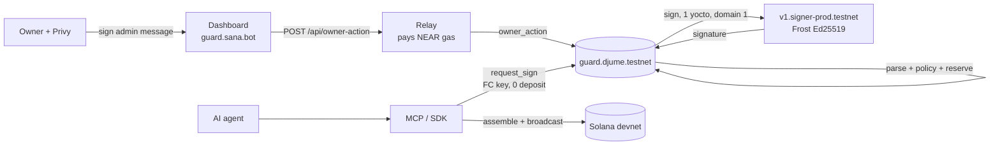
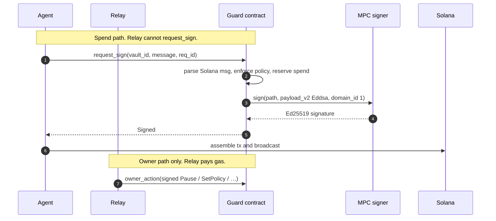

# Sana Guard

**A policy-enforced agent wallet: NEAR is the only signer for an AI agent's Solana funds.**

AI agents that hold a hot Solana key can be drained by a leak or a prompt injection. Sana Guard removes that key. A NEAR contract (`guard.djume.testnet`) holds per-vault policy and asks NEAR Chain Signatures (MPC, Ed25519) to sign a Solana transaction **only if the parsed message passes that policy**.

NEAR Hackathon · AI Security & Defense · submit by 14 Nov 2026 (WIB). Testnet / Solana devnet only.

**Demo video:** `<VIDEO_URL>` — recording script in [docs/DEMO.md](./docs/DEMO.md).

Judges can open [vault 0](https://guard.sana.bot/vaults/0) **without logging in**: read-only policy, balance, recipients, and the Attack lab UI. The hosted Attack lab is preconfigured. Self-hosting it needs `ATTACK_LAB_TOKEN` (name only; never commit the value).

## The problem

An agent with a raw key is a hot wallet with an LLM in front of it. Caps in the prompt are not enforcement. Sana Guard moves the caps on-chain: per-tx limit, rolling 24h cap, recipient and program allowlists, priority-fee caps, expiry, idempotency, and a kill switch. A leaked agent function-call key still cannot spend past those rules.

## How it works

Owners log in with a Privy embedded Solana wallet. The dashboard signs admin messages; a Railway relay (`apps/relay`, Hono + SQLite) pays NEAR gas and submits them. Agents never see the owner key. They call `request_sign` themselves, through `packages/sdk` or `apps/mcp`. The relay cannot call `request_sign` and holds no agent keys.



Agent spend (the relay is **not** on this path):



Derivation path is `vault/<owner_solana_pubkey>/<vault_id>`. The vault Solana address is the MPC `derived_public_key` for that path, predecessor `guard.djume.testnet`, domain `1`. Hosted vault 0 is `Fkk515Q2ZKeg3aqkcpSwVvFbDVj8VVDesHwWttbtMbgU`.

## Policy model

Every `request_sign` fails closed with a stable `SG_E###` panic. Evaluation order matches `process_sign_request` / `check_instruction_policy` in [`contracts/guard/src/policy.rs`](./contracts/guard/src/policy.rs). Messages are legacy or v0 only (no ALTs, no tx-format v1 / `0x81`).

| Step | What it checks | Code |
| --- | --- | --- |
| Pause + agent/vault | Global pause, registered agent, vault exists and is Active, not paused | `SG_E051`–`E056`, `SG_E076` |
| Expiry | `now < expires_at_ns` | `SG_E057` |
| Idempotency | 32-byte `req_id`; message hash unseen in 24h | `SG_E058`–`E060` |
| Message parse | Size 32–1167, 1 signer, ≤8 ixs, no ALTs, supported programs | `SG_E001`–`E050` |
| Fee payer | Message signer is the vault address | `SG_E061` |
| Per-ix programs | Vault allowlist; unsupported program is `E018` during parse | `SG_E074`, `SG_E018` |
| Per-ix destination | System / SPL / ATA recipient; SPL and ATA mint in policy | `SG_E067`–`E071` |
| Per-ix CU price + memo | CU micro-lamports vs cap; memo UTF-8 length | `SG_E072`, `SG_E073` |
| Total priority fee | Optional `max_total_priority_fee_lamports` | `SG_E078` |
| Per-tx limit | Spend per mint ≤ `per_tx_limit` | `SG_E062`, `SG_E063` |
| Rolling 24h cap | Hourly buckets, 24h window | `SG_E064`, `SG_E065` |
| Prepaid gas | Enough left for MPC sign + callback + buffer | `SG_E066` |

Supported instructions: System `Transfer`, SPL Token `Transfer` / `TransferChecked`, ATA `CreateIdempotent`, ComputeBudget setLimit / setPrice, Memo. Tightening a policy is immediate; loosening waits `loosen_delay_ns`. Spend is reserved when the signature is issued. Full map: [`packages/sdk/src/errors.ts`](./packages/sdk/src/errors.ts) (`SG_E001`–`SG_E078`).

Live vault 0 (verified against `get_vault`): **0.05 SOL** per tx, **0.1 SOL** / 24h, CU price cap **100000** lamports, no total priority-fee cap, System + Compute Budget, recipient `DeF8KCnMiARMuEUjc1iD4wGh8g8D7ygSUVGnYw8XMvmB`, agent `agent1.guard.djume.testnet`, expiry 29 Nov 2026 12:17 UTC, 1h loosen delay.

## Live

| What | Link |
| --- | --- |
| Dashboard | https://guard.sana.bot |
| Vault 0 (public views + Attack lab) | https://guard.sana.bot/vaults/0 |
| Guard contract (NEAR testnet) | https://testnet.nearblocks.io/address/guard.djume.testnet |
| Sample signed Solana **devnet** tx | [5w6yEG25…BY1CX1r](https://explorer.solana.com/tx/5w6yEG25bVffWMFERM4LF9oJVmtGutZqbC1WrA7bx43UWvEJcCeFueU9xDaYkNrLuRrVkySSjQZcm5FsuBY1CX1r?cluster=devnet) — 5000 lamports, vault `Fkk515…` → `DeF8…`, confirmed |
| Vault Solana address | https://explorer.solana.com/address/Fkk515Q2ZKeg3aqkcpSwVvFbDVj8VVDesHwWttbtMbgU?cluster=devnet |

On-chain `version()` reports `0.1.0` / git `9cb56bd5c761`. Hosted relay health is testnet + `guard.djume.testnet`. Demo video script: [`docs/DEMO.md`](./docs/DEMO.md). Form paste: [`docs/SUBMISSION.md`](./docs/SUBMISSION.md).

## Security model and limits

**On-chain.** Policy lives in the guard. The agent key is a function-call key on `<name>.guard.djume.testnet` that can only call `request_sign`. The relay only forwards owner-signed messages (`ed25519_verify` + nonce + network/contract tags). Compromising the relay is censorship / DoS, not spend.

**Hosted demo caps** (live `GET /api/owner-action`):

| Cap | Value | Where |
| --- | --- | --- |
| `MAX_RELAY_VAULTS_TOTAL` | **10** | Dashboard create-vault |
| Vaults per owner | **1** (`MAX_VAULTS_PER_OWNER`) | Dashboard + live relay |
| Agents per vault | **3** (`MAX_AGENTS_PER_VAULT`) | Dashboard (contract hard max is 8) |
| Agent gas funding | **0.25 NEAR** (`MAX_AGENT_GAS_FUNDING_NEAR`) | Dashboard + live relay (contract allows 0.15–0.5) |

The agent FC-key allowance on-chain is 0.25 NEAR. CreateVault storage deposit is ~0.5 NEAR, paid by the relay.

**Networks.** NEAR **testnet** and Solana **devnet** only. The dashboard and MCP refuse mainnet unless you explicitly configure it. There is no mainnet deploy. **Do not put real funds here** without an audit.

**Admin key.** `djume.testnet` can upgrade the contract. That is disclosed; mainnet `guard.djume.near` is a later, approval-gated step.

## Quickstart

### SDK (agent)

`@sana-guard/sdk` is **not on npm** yet. Clone the monorepo and build it:

```bash
git clone https://github.com/0xjume/sana-guard
cd sana-guard
pnpm install
pnpm --filter @sana-guard/sdk build
```

Depend on it with `"@sana-guard/sdk": "workspace:*"` (this repo) or `"@sana-guard/sdk": "file:../sana-guard/packages/sdk"` (another project).

```ts
import { Connection, PublicKey } from '@solana/web3.js';
import { connect, keyStores } from 'near-api-js';
import { AgentClient } from '@sana-guard/sdk';

const near = await connect({
  networkId: 'testnet',
  keyStore: new keyStores.UnencryptedFileSystemKeyStore('/path/to/.near-credentials'),
  nodeUrl: 'https://rpc.testnet.near.org',
});
const client = new AgentClient(
  new Connection('https://api.devnet.solana.com', 'confirmed'),
  await near.account('agent1.guard.djume.testnet'),
  'guard.djume.testnet',
  new PublicKey('Fkk515Q2ZKeg3aqkcpSwVvFbDVj8VVDesHwWttbtMbgU')
);

const result = await client.transfer(0, {
  to: new PublicKey('DeF8KCnMiARMuEUjc1iD4wGh8g8D7ygSUVGnYw8XMvmB'),
  lamports: 5_000n,
});
console.log(result.explorer);
```

Owner helpers (`createVaultAction`, `setPolicyAction`, `pauseAction`, …) live in the same package. See [`packages/sdk/README.md`](./packages/sdk/README.md).

### MCP (agents)

```bash
pnpm --filter @sana-guard/sdk build
pnpm --filter @sana-guard/mcp build
# set NEAR_NETWORK, NEAR_RPC_URL, GUARD_CONTRACT_ID,
# NEAR_ACCOUNT_ID, NEAR_KEY_FILE or NEAR_PRIVATE_KEY,
# SANA_GUARD_VAULT_ID, SOLANA_RPC_URL  (names only — never commit keys)
pnpm --filter @sana-guard/mcp start
```

Tools: `sana_guard_status`, `sana_guard_get_policy`, `sana_guard_check_transfer`, `sana_guard_transfer_sol`, `sana_guard_transfer_spl`, `sana_guard_sign_transaction`, `sana_guard_get_request`. No owner/admin tools. Skill: [`skills/sana-guard/SKILL.md`](./skills/sana-guard/SKILL.md).

### Run locally

```bash
pnpm install
pnpm --filter @sana-guard/sdk build

# Dashboard — copy apps/dashboard/.env.example → .env.local (set NEXT_PUBLIC_PRIVY_APP_ID)
pnpm --filter @sana-guard/dashboard dev

# Relay — copy apps/relay/.env.example → .env (set RELAY_ACCOUNT_ID, RELAY_NEAR_PRIVATE_KEY)
pnpm --filter @sana-guard/relay dev

# Contract
cd contracts/guard && cargo test && cargo near build non-reproducible-wasm --no-abi
```

Need: Node 20+, pnpm 9+, Rust stable with `wasm32-unknown-unknown`, cargo-near. Markdown is not in the Prettier glob.

## Repo layout

```
contracts/guard          NEAR contract (Rust, near-sdk 5.30)
contracts/mock-mpc       Test-only MPC mock
packages/sdk             TypeScript SDK
apps/relay               Hono + SQLite relay (Railway)
apps/dashboard           Next.js owner console (Vercel)
apps/mcp                 MCP server for agents
skills/sana-guard        Agent skill
scripts/spikes           Research / day-1 MPC spike
docs/                    PLAN, NOTES, TESTING, DEMO, SUBMISSION
```

## Tests and CI

[`.github/workflows/ci.yml`](./.github/workflows/ci.yml) on `main` and `cursor/**`:

| Job | Checks |
| --- | --- |
| Rust | `cargo fmt`, clippy `-D warnings`, `cargo test`, WASM build |
| TypeScript | Prettier (TS/JS/JSON), SDK + MCP lint / typecheck / test / build |
| Dashboard | lint, typecheck, vitest, `next build` |
| Relay | lint, typecheck, vitest |
| Relay docker | image build + `/v1/health` |

```bash
pnpm format:check
pnpm --filter @sana-guard/sdk test
pnpm --filter @sana-guard/mcp test
pnpm --filter @sana-guard/dashboard test
pnpm --filter @sana-guard/relay test
cd contracts/guard && cargo test
```

Live tests (`SANA_GUARD_LIVE=1`, `RELAY_LIVE=1`) are opt-in and not run in CI.

## Roadmap

- Self-audit against [`docs/PLAN.md`](./docs/PLAN.md) §7, longer parser fuzz, gas profiling
- Mainnet `guard.djume.near` only after an explicit approval — not in this submission
- Stretch: durable nonce if MPC latency needs it; more programs behind the same fail-closed parser

## License

MIT — see [LICENSE](./LICENSE). Copyright (c) 2026 Jume / 0xjume.
