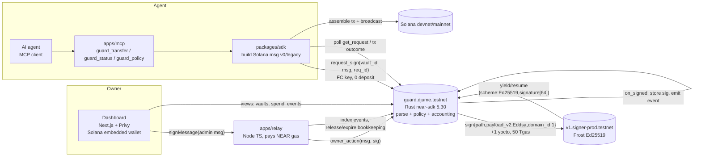

# Sana Guard: build plan (NEAR Hackathon, Nov 1–15 2026 WIB, AI Security & Defense)

Status: plan v1, Oct 30 2026 (WIB). **Testnet accounts created on Oct 30, about 14:05 WIB; see §13.** It builds on the design draft, whitepaper v0.1 and idea shortlist canvases rather than replacing them.
Snippets and citations are in [NOTES.md](./NOTES.md). Tags: **[V]** = verified this session, **[S]** = from source/docs, **[?]** = unverified (spike).

**One-liner:** a NEAR contract that is the *only* signer for AI agents' Solana wallets. It asks the NEAR MPC network (Chain Signatures, Ed25519) to sign a Solana transaction **only if the parsed transaction passes the owner's policy**. Leaking an agent key, or prompt-injecting the agent, cannot get around the caps.

---

## 1. Decisions (carried from the canvases, with changes noted)

| # | Decision | Note |
|---|---|---|
| D1 | Fresh public monorepo `sana-guard`; MIT (pending Jume); **no private Sana code copied** | Patterns reimplemented from scratch |
| D2 | Testnet first: `djume.testnet` and `guard.djume.testnet`. Mainnet `guard.djume.near` only after approval | Neither testnet account exists yet [V] |
| D3 | MPC = `v1.signer-prod.testnet` / `v1.signer`, **domain_id 1** (Frost/Ed25519) [V] | Not `v1.signer.testnet`, which does not exist [V] |
| D4 | Path = `vault/<owner_solana_pubkey_b58>/<vault_id>`; predecessor = guard contract | Supersedes the draft's `vault/<owner>/<vault_id>` |
| D5 | Payload = **full Solana message bytes** (legacy or v0 without ALTs), hex, ≤ 1167 bytes (1232 minus 1 + 64 sig bytes) [V/S] | Reject Solana tx-format v1 (`0x81`) in MVP |
| D6 | Agent calls `request_sign` with an FC key and **zero deposit**; the **contract pays 1 yocto** to MPC from its own balance | FC keys cannot attach a deposit [V docs]; spike S1 checks it live |
| D7 | Owner = Privy embedded Solana wallet. Admin actions are owner-signed messages verified with `env::ed25519_verify` (near-sdk 5.30.0 [V]); the relay submits and pays gas | |
| D8 | **Agent identity: option B (default)** = `<agent>.guard.djume.testnet` subaccount created *by the contract*, holding one FC key (receiver = guard, method = `request_sign`). Auth = `predecessor_account_id`. **Fallback option A** = FC key on the guard account, auth via `env::signer_account_pk()` | B matches the brief and keeps agent gas off the guard balance. A is cheaper (no per-agent funding). See Q6 |
| D9 | Spend is **reserved at sign time**: a signature is treated as money out. An expired or unbroadcast tx is released only by an owner `release` action | Conservative; the relay cannot inflate the budget |
| D10 | The contract does not derive keys. The vault address comes from MPC `derived_public_key` (SDK/relay) and is stored at `create_vault`; the owner's signed create message includes it | Offline derivation matches on-chain [V] |
| D11 | 1Click/Intents payouts are a stretch goal, using `dry:true` quotes only (no testnet) | |

## 2. Architecture



**Flow (agent spend):**
1. The agent calls MCP `guard_transfer`.
2. The SDK builds a v0 message with the vault address as fee payer and a fresh blockhash (or durable nonce).
3. The agent's FC key calls `guard.request_sign` (about 300 Tgas, 0 deposit).
4. The contract parses the message, evaluates the policy, reserves the spend and records the request.
5. It sends `Promise(v1.signer-prod).sign(..)` with 1 yocto, then `.then(on_signed)`.
6. MPC responds via yield/resume, and `on_signed` stores the signature (or releases the reservation on failure).
7. The tx's return value is the signature. The SDK attaches it (`[1, sig, message]`) and broadcasts to Solana.

## 3. Contract interface (`contracts/guard`)

### 3.1 Storage layout (near-sdk `store::*`, unique `BorshStorageKey` prefixes)
```rust
#[derive(BorshStorageKey)] #[near]
enum Key { Vaults, AgentToVault, Requests, OwnerNonce, Recipients{vault:u32}, Programs{vault:u32}, Mints{vault:u32}, TokenAccts{vault:u32}, Buckets{vault:u32} }

#[near(contract_state)] #[derive(PanicOnDefault)]
pub struct Guard {
  mpc_contract: AccountId,          // v1.signer-prod.testnet
  mpc_domain_id: u32,               // 1
  network_tag: String,              // "near-testnet" (bound into admin msgs)
  admin: AccountId,                 // djume.testnet: upgrades + global pause only, NO spend power
  global_paused: bool,
  vaults: IterableMap<u32, Vault>,  // vault_id -> Vault
  agent_to_vault: LookupMap<AccountId, u32>,   // option B (option A: LookupMap<PublicKey,u32>)
  owner_nonce: LookupMap<[u8;32], u64>,        // owner solana pubkey -> last used nonce
  requests: LookupMap<[u8;32], SignRequest>,   // req_id -> record (idempotency + result)
  next_vault_id: u32,
}

#[near(serializers=[borsh])]
pub struct Vault {
  owner: [u8;32],                   // Privy Solana pubkey
  vault_address: [u8;32],           // MPC-derived Solana address (fee payer)
  path: String,                     // vault/<owner_b58>/<id>
  agents: Vec<AccountId>,           // bounded (≤ 8)
  policy: Policy,
  pending_loosen: Option<(Policy, u64 /*effective_ns*/)>,
  recipients: LookupSet<[u8;32]>,   // SOL wallets AND token accounts allowed as destinations
  token_accounts: LookupMap<[u8;32], ([u8;32] /*mint*/, u8 /*decimals*/)>, // vault's own source ATAs
  buckets: LookupMap<u64 /*hour*/, Vec<([u8;32] /*mint*/, u64)>>, // rolling-24h spend (hourly)
  spent_cursor: u64,                // for pruning old buckets (bounded work per call)
  paused: bool,
}

#[near(serializers=[borsh,json])]
pub struct Policy {
  per_tx_limit: Vec<(Mint, U64)>,   // Mint = "SOL" or base58 mint; native lamports for SOL
  daily_cap: Vec<(Mint, U64)>,      // rolling 24h
  programs: Vec<Base58>,            // subset of SUPPORTED_PROGRAMS
  max_priority_fee_lamports: U64,
  max_memo_len: u16,
  expires_at_ns: U64,
  loosen_delay_ns: U64,             // e.g. 1h; tightening is instant
}

#[near(serializers=[borsh,json])]
pub struct SignRequest { vault_id: u32, agent: AccountId, msg_hash: [u8;32], spend: Vec<(Mint,u64)>,
  hour: u64, status: Status /*Pending|Signed|Failed|Released*/, signature: Option<Vec<u8>>, created_ns: u64 }
```

### 3.2 Methods
| Method | Caller | Notes |
|---|---|---|
| `#[init] new(mpc_contract, mpc_domain_id, network_tag, admin)` | deployer | `#[init]`; `PanicOnDefault` |
| `owner_action(msg: String, sig: Base64VecU8)` | anyone (relay) | Parses the admin msg, checks `ed25519_verify(sig, msg_bytes, owner)`, nonce > last, expiry, contract id, network tag. Dispatches the variants below |
| ↳ `CreateVault{vault_address, policy}` | owner | `owner` = signer pubkey in msg. Checks `vault_address` against `path` *off-chain*; [?] optional on-chain check via view-call promise |
| ↳ `AddAgent{name, gas_funding}` / `RemoveAgent{agent}` | owner | B: `Promise::new(name.guard...).create_account().transfer(f).add_access_key_allowance(agent_pk, allowance, guard, "request_sign")` + 15 Tgas `on_agent_created` callback. Panics `SG_E077_AGENT_EXISTS` if `{name}.{guard}` is already registered. Prepaid gas: at least 50 Tgas works live. Remove = state disable (key stays but is useless) |
| ↳ `SetPolicy{policy}` | owner | Stricter applies instantly; looser goes to `pending_loosen` |
| ↳ `AddRecipient/RemoveRecipient`, `RegisterTokenAccount{ata, mint, decimals}` | owner | Add = loosen (delayed); remove = instant |
| ↳ `Pause/Unpause` (kill switch) | owner | Pause is instant; unpause is instant (owner-signed) |
| ↳ `Release{req_id}` | owner | Returns reserved spend for a signed tx that never landed (the owner asserts it) |
| ↳ `Withdraw{...}` | n/a | Not a contract method: the owner builds a tx to **owner pubkey only**. Allowed by an owner-signed `SignOwnerTx{message}` that bypasses caps only if every destination == owner |
| `request_sign(vault_id: u32, message_b64: Base64VecU8, req_id: Base64VecU8) -> Promise` | registered agent | Core path (§5). No deposit. Needs about 300 Tgas |
| `#[private] on_signed(req_id, #[callback_result] r: Result<MpcSignature, PromiseError>) -> Option<Base64VecU8>` | self | **Never panics**: on Ok stores the sig and status Signed; on Err releases the reservation and sets status Failed |
| `apply_pending_policy(vault_id)` | anyone | After the delay |
| `admin_pause_all(bool)` | admin, `assert_one_yocto` | Global kill switch |
| Views | | `get_vault`, `get_policy`, `get_request(req_id)`, `get_spend_24h(vault_id)`, `list_vaults(from,limit)`, `supported_programs()`, `owner_nonce(owner)` |

**Admin message format** (UTF-8, human-readable so Privy shows it):
```
SANA-GUARD-ADMIN-v1
network: near-testnet
contract: guard.djume.testnet
vault: 3
nonce: 17
expires: 1793000000000000000
action: {"SetPolicy":{...}}
```
The contract parses it strictly: fixed line order, no extra lines, `action` JSON with `serde(deny_unknown_fields)`.

### 3.3 Events (NEP-297, `EVENT_JSON:{"standard":"sana_guard","version":"1.0.0","event":..,"data":[..]}`)
`vault_created`, `agent_added`, `agent_removed`, `policy_changed`, `policy_loosen_scheduled`, `paused`, `unpaused`, `sign_requested` (req_id, vault, agent, spend, msg_hash), `sign_rejected` (reason code; only if Q7 picks non-panicking rejects, otherwise the panic message `SG_E###` is the record), `signed`, `sign_failed`, `released`.

## 4. Chain Signatures call: exact shape and derivation [V]

```rust
const MPC_SIGN_GAS: Gas = Gas::from_tgas(50);      // live config requires ≥15 Tgas
const ON_SIGNED_GAS: Gas = Gas::from_tgas(15);
#[derive(Serialize)] struct SignArgs<'a> { request: SignReq<'a> }
#[derive(Serialize)] struct SignReq<'a> { path: &'a str, payload_v2: PayloadV2, domain_id: u32 }
#[derive(Serialize)] enum PayloadV2 { Eddsa(String) }               // hex(message)

Promise::new(self.mpc_contract.clone())
  .function_call("sign".into(), serde_json::to_vec(&SignArgs{..})?,
                 NearToken::from_yoctonear(1), MPC_SIGN_GAS)
  .then(Self::ext(env::current_account_id()).with_static_gas(ON_SIGNED_GAS).on_signed(req_id))
```
- The response JSON is `{"scheme":"Ed25519","signature":[64 u8]}` [V on-chain]. **The skill's `{"Ed25519":{...}}` shape is wrong.**
- Derivation: `sha3_256("near-mpc-recovery v0.1.0 epsilon derivation:" + "guard.djume.testnet" + "," + path)` → scalar; `root + tweak·G`. The result equals `derived_public_key` [V]. Source: `near/mpc crates/near-mpc-crypto-types/src/kdf.rs`.
- Coalescing: MPC merges identical (caller, path, payload) requests that are pending (queue ≤ 128). Our `req_id` + `msg_hash` dedupe happens before that, so spend is never double-counted.

## 5. Solana parsing (in-contract, hand-rolled, no_std-style, no `solana-*` crates)

**Input:** the raw message. Reject with a reason code on any failure (fail closed).
1. `len ∈ [32, 1167]`.
2. **Version:**
   - b0 & 0x80 == 0 → legacy.
   - b0 == 0x80 → v0.
   - Anything else (0x81+, Solana tx-format v1) → `UnsupportedVersion`.
3. **Header:**
   - `num_required_signatures == 1` (only the vault signs)
   - `num_readonly_signed == 0`
   - `num_readonly_unsigned < n_keys`
4. **Account keys:**
   - Read via canonical shortvec (reject non-minimal encodings and > 64 keys).
   - `keys[0] == vault.vault_address` (fee payer and sole signer).
5. **Recent blockhash:** 32 bytes, opaque.
6. **Instructions:** shortvec count ≤ 8. For each one:
   - `program_id_index < n_keys` and != 0
   - account indexes < n_keys
   - data via shortvec
7. **Trailer:**
   - v0: `address_table_lookups` count **must be 0** (ALTs hide accounts).
   - Then **exactly at end of buffer**: trailing bytes cause a reject.
8. **Dispatch** on program id (must be in `vault.policy.programs` ∩ SUPPORTED). Every instruction must decode fully, with an exact data length.

**Supported in v1:**

| Instruction | Checks | Spend |
|---|---|---|
| System `Transfer` (u32 2 + u64) [V layout] | `from == keys[0]`; `to ∈ recipients` | SOL += lamports |
| SPL Token `TransferChecked` (12) | `authority == vault`; `source ∈ token_accounts` with mint == ix mint and matching decimals; `mint ∈ policy`; `dest ∈ recipients` | mint += amount |
| SPL Token `Transfer` (3) | `authority == vault`; `source ∈ token_accounts` (gives the mint); `dest ∈ recipients` | mint += amount |
| ATA `CreateIdempotent` (1) | `payer == vault`; `ata ∈ recipients`; `mint ∈ policy`; token program == SPL Token | SOL += rent estimate constant (2_039_280) |
| ComputeBudget `SetComputeUnitLimit` / `SetComputeUnitPrice` | at most one each; `limit*price/1e6 ≤ max_priority_fee_lamports` | SOL += priority fee |
| Memo v2 | `len ≤ max_memo_len`; UTF-8 | 0 |
| System `AdvanceNonceAccount` (4), **stretch** | only as instruction 0; authority == vault; nonce account registered | 0 |

**Rejected:**
- Token-2022
- any other program
- `Approve`/`SetAuthority`/`CloseAccount`/`Burn`
- System `Assign`/`CreateAccount`/`Allocate`
- writable or duplicate abuse of `keys[0]` beyond the allowed roles
- multiple signers

The "arbitrary tx" story for later is an owner-opted *opaque program allowlist* (stretch): the instruction is allowed but its spend is counted as unknown, which requires a separate `opaque_daily_count` cap.

**Tests:**
- Golden fixtures produced by `@solana/kit` + `@solana-program/{system,token,memo,compute-budget}` and by `omni-transaction` 0.5 (Rust encoder).
- A cargo-fuzz / proptest on the parser (no panics, bounded gas).

## 6. Policy evaluation order (cheapest first; every step fails closed)

1. `!global_paused`.
2. Caller → vault: `agent_to_vault[predecessor] == vault_id` and the agent is active.
3. Vault: exists, `!paused`, `now < policy.expires_at_ns`.
4. Idempotency: `req_id` not in `requests`; also `msg_hash` not seen in the last 24h (per-vault ring of hashes in buckets).
5. Size and version (§5 steps 1–2).
6. Full strict parse (§5 steps 3–7).
7. Program allowlist and per-instruction checks (recipients, mints, authorities).
8. Sum spend per mint (checked math). Then:
   - each mint ≤ `per_tx_limit` (a mint with no limit configured is rejected)
   - spend in the rolling 24h window plus this spend ≤ `daily_cap` (24 hourly buckets; prune ≤ 24 per call)
9. Gas guard: `env::prepaid_gas() - used ≥ MPC_SIGN_GAS + ON_SIGNED_GAS + 10 Tgas`.
10. **Commit state** (reserve spend, insert `SignRequest{Pending}`, emit `sign_requested`) **before** creating the promise.
11. MPC promise, then `on_signed`.

Any later state change happens only in `on_signed`, which is `#[private]` and never panics.

## 7. Threat model and audit checklist

**Assets:**
- funds at MPC-derived Solana vault addresses
- policy integrity
- the guard's NEAR balance (gas, 1 yocto, subaccount funding)

| Threat | Mitigation |
|---|---|
| Agent key leaked / prompt-injected agent | Caps, recipient/program allowlists and expiry enforced on-chain; owner kill switch; agent removal |
| Malicious tx crafted to hide transfers (ALTs, v1 format, trailing bytes, dup accounts, CPI via unknown program) | Strict parser, ALT=0, version ≤ 0x80, exact-length decode, program allowlist with no opaque programs in MVP |
| Replay / double accounting | `req_id` + `msg_hash` dedupe; Solana itself dedupes identical signed txs |
| Signed tx never broadcast, budget "leaks" | Conservative: counts as spent; owner `Release` |
| Relay compromise | The relay only *submits* owner-signed messages. It cannot forge (ed25519_verify), replay (nonce) or cross-contract/network replay (tags). Worst case: censorship/DoS, mitigated because the owner can submit directly from any NEAR account |
| Privy key compromise | Out of scope (equivalent to owner compromise); loosening delay gives a window for detection; Withdraw only to the owner |
| Guard admin key | Can upgrade code = can bypass everything. Mitigation: disclose it; plan to lock the account or move to a DAO/multisig post-hackathon; upgrades are visible on-chain |
| MPC liveness / timeout | `on_signed` Err releases the reservation; the SDK retries with a fresh blockhash |
| Blockhash expiry vs MPC latency | Spike S2; durable-nonce fallback |
| Gas griefing (huge messages, many instructions) | Size ≤ 1167, ≤ 8 instructions, ≤ 64 keys, bounded bucket pruning, ≤ 8 agents per vault |
| Storage DoS (vault/request spam) | `CreateVault` requires an owner sig and a vault cap per owner; requests pruned after 7 days (`cleanup(req_ids)`); [?] storage deposit by the relay |
| Guard NEAR balance drained via FC-key gas | Option B: the agent's own subaccount pays gas. Option A: per-key allowance |

**Audit checklist (mapped to `~/.agents/skills/near-contract-audit`):**

| Detector | Where it applies | Plan |
|---|---|---|
| H non-private-callback | `on_signed`, `on_agent_created` | `#[private]` + unit test that an external call fails |
| H reentrancy | `request_sign` → MPC | All state committed before the promise; the callback re-reads state by req_id; no assumption about interleaving (other requests may land in between) |
| H incorrect-argument-or-return-types | amounts, ns timestamps | `U64`/`U128` in JSON; `Base64VecU8` for bytes |
| H unsaved-changes | `Vault` inside `IterableMap` | Use `get_mut` / re-insert; tests read back after each action |
| H owner-check | `owner_action`, `request_sign`, admin | ed25519 sig + nonce for owners; predecessor map for agents; admin == predecessor |
| H yocto-attach | admin methods (full-access path) | `assert_one_yocto` on `admin_*`. **Intentionally not** on `request_sign` (FC key cannot attach) or `owner_action` (sig-auth via relay). Documented as accepted |
| H storage-collision | per-vault collections | `Key::Recipients{vault}` etc. with the vault id in the prefix |
| H required-initialization-macro | `new` | `#[init]`, `PanicOnDefault` |
| M gas-griefing | parser, buckets, agent lists | Hard bounds (§7 table) |
| M insecure-random | none | No randomness used |
| M prepaid-gas | MPC + callback | Explicit gas check (§6 step 9); near-workspaces test at minimum gas |
| L cover-storage-cost | vault/recipient/request inserts | Measure `storage_usage` deltas; the guard pays from a funded balance plus per-owner caps (Q8) |
| L unsafe-math | spend sums | `checked_add`, `overflow-checks = true` |
| L float-math | none | Integers only |

Additional (not in the skill):
- the parser fuzz test
- ed25519 malleability (rely on host fn semantics)
- admin message canonicalization
- event-before-panic ordering

## 8. Off-chain components

- **packages/sdk** (TS: near-api-js 7.x or near-kit 0.20, @solana/kit 8.x):
  - `deriveVaultAddress()` via the MPC view
  - `buildTransfer()` → **version 0 / legacy only**, vault as payer
  - `requestSign()` → submits with the agent FC key, waits for the final outcome, decodes `{scheme,signature}`
  - `assembleAndSend()` and `explainRejection(code)`
  - Admin msg builder plus `signAdmin(privyWallet)`
- **apps/relay** (Node TS on Railway, or a Cloudflare Worker):
  - `POST /owner-action {msg,sig}` → pre-validates (sig, nonce, expiry) and submits with the relay's key (a function-call key on the relay account for `owner_action`; relay pays gas)
  - Indexes events (`EXPERIMENTAL_changes` or a NEAR Lake/nearblocks poll) for the dashboard
  - Rate limit per owner
  - Optional `POST /broadcast` for agents without Solana RPC
  - Holds **no** spend authority
- **apps/mcp** (MCP server for agents):
  - `guard_transfer{to, amount, mint?, memo?}`
  - `guard_status` (vault, remaining 24h budget, pause)
  - `guard_policy` (read-only)
  - `guard_payout_quote` (stretch; 1Click `dry:true`)
  - Ships with `skills/sana-guard/SKILL.md`, teaching agents to treat a rejection as final (no retry loops).
- **apps/dashboard** (Next.js on Vercel, Privy):
  - login → create vault (shows the derived address and fund QR)
  - policy editor (diff + "loosen takes 1h" warning)
  - add agent (shows the FC key once)
  - kill switch
  - live feed of signed/rejected attempts
  - "Attack lab" demo buttons: over-cap, wrong recipient, unknown program, expired, replay, ALT smuggling

## 9. Day-by-day (WIB)

| Day | Date | Work | Exit criteria |
|---|---|---|---|
| 1 | Sat Nov 1 | **Riskiest-first spike** (needs approvals A2 and A4). Minimal `spike-signer` contract on a throwaway testnet account: `request_sign(msg)` → MPC `sign` (+1 yocto, contract-paid) → callback returns sig. Script: build a devnet SOL transfer from the derived address (airdrop devnet SOL), call via an **FC key with 0 deposit**, attach the sig, broadcast. Measure S1 (FC key + contract-paid yocto), S2 (latency vs blockhash), S3 (gas) | A devnet tx sig is on the explorer; latency/gas numbers are in docs/spikes.md |
| 2 | Sun Nov 2 | Repo scaffold (A1), CI (cargo test, clippy, wasm build, pnpm). Parser crate `sana-solana-parse` + fixtures from @solana/kit and omni-transaction; proptest | All §5 fixtures pass; fuzz runs 10 min with no panic |
| 3 | Mon Nov 3 | Contract state, `new`, `owner_action` (ed25519_verify + nonce + tags), CreateVault/SetPolicy/Pause. Privy signMessage spike (S4) | A Privy-signed msg is verified in a near-workspaces test |
| 4 | Tue Nov 4 | `request_sign` full path: policy order §6, buckets, reservations, `on_signed`, events | near-workspaces tests with a **mock MPC** contract (returns `{scheme,signature}` / times out) |
| 5 | Wed Nov 5 | Agents: AddAgent (option B subaccount + FC key) / RemoveAgent; deploy to `guard.djume.testnet` (A2); live MPC E2E | An agent subaccount signs a real devnet transfer through the guard |
| 6 | Thu Nov 6 | SDK (build, request, assemble, send, explain); SPL TransferChecked plus ATA create E2E on devnet (devnet USDC or a self-minted test mint) | SPL E2E green |
| 7 | Fri Nov 7 | Relay (owner-action endpoint, event indexer) on Railway (A5) | The dashboard can drive admin actions end-to-end |
| 8 | Sat Nov 8 | Dashboard: Privy login (A3), vault create, policy editor, kill switch | The owner flow works on testnet |
| 9 | Sun Nov 9 | MCP server + skill; agent demo (e.g. a Claude/Grok agent paying invoices) | An agent pays an allowlisted recipient; an injected "send to attacker" is rejected |
| 10 | Mon Nov 10 | Attack lab + rejection reason codes surfaced in the UI; loosen-delay flow | 6 attack demos are reproducible |
| 11 | Tue Nov 11 | Self-audit against §7 checklist; fuzz longer; gas profiling; cleanup methods | Audit notes in docs/audit.md |
| 12 | Wed Nov 12 | Stretch: durable nonce **or** 1Click dry quotes **or** option-A agent keys (whichever S2/Q6 says matters) | |
| 13 | Thu Nov 13 | Mainnet decision (A6): if approved, deploy `guard.djume.near` and run one small real transfer | Mainnet tx or a documented skip |
| 14 | Fri Nov 14 | Docs, README, architecture diagram, demo video recording | Video < 3 min |
| 15 | Sat Nov 15 | Buffer + submission | Submitted |

**Day-1 spike details:**
- **S1 (deposit):** call `spike.request_sign` with an FC key (0 deposit). Expect the outgoing MPC receipt to carry 1 yocto from the contract balance and succeed. Also confirm that a direct FC-key → MPC `sign` call fails, to document it.
- **S2 (latency):** time from `request_sign` inclusion to `on_signed`, repeated 10×. If p95 > about 45 s (blockhash ~60 s, with margin for broadcast), switch to durable-nonce accounts. That means AdvanceNonceAccount support in the parser, plus one nonce account per vault created by an owner-signed tx.
- **S3 (gas):** total Tgas for a 1-instruction and an 8-instruction message, with the parse cost isolated via a view-like dry-run method (`check_only`).
- **S4 (Privy):** confirm `signMessage` signs raw bytes (no prefix) and verifies with `env::ed25519_verify`.

## 10. Open questions and risks

**Questions for Jume:**
- **Q1** Repo owner: `0xjume` or `sanafi-onchain`?
- **Q2** MIT license?
- **Q3** Mainnet in scope, or testnet-only submission?
- **Q4** Solo or team?
- **Q5** OK to spend about $30–50 on mainnet testing?
- **Q6** Agent identity: subaccounts `<agent>.guard.djume.testnet` (B, default; costs about 0.05–0.1 NEAR funding per agent) or FC keys on the guard account (A, cheapest)?
- **Q7** Rejections: return `Err` reason without a panic (so it is logged and the tx succeeds) vs panic (the tx fails, clearer for wallets). Recommendation: panic with a stable `SG_E###` code; the relay indexes failed receipts.
- **Q8** Who pays storage for vaults: the guard balance plus per-owner caps (MVP), or a storage deposit via the relay?

**Risks (ranked):**
1. **MPC latency vs blockhash lifetime** (~60 s). Mitigation: durable nonce. [?] until S2.
2. **Contract-paid 1 yocto from an FC-key-initiated call.** Believed fine; [?] until S1. Fallback: the relay submits `request_sign` with its full-access key plus 1 yocto on behalf of agent-signed requests (agent auth via ed25519 sig, like the owner path).
3. **Gas:** parse + policy + MPC (≥15 Tgas) + callback within 300 Tgas. Likely fine; [?] until S3.
4. **Solana tx-format v1 (0x81)** is now live on mainnet (Sep 15 2026). Kit plugin clients may default to it, and MPC accepts at most 1232 bytes, so the SDK must force v0/legacy. Wallet/tooling drift is possible.
5. **Parser bugs = fund loss.** Mitigation: strict whitelist, fuzzing, minimal instruction set.
6. **Upgrade key = backdoor.** Disclose; lock post-hackathon.
7. **MPC testnet instability**, given resharing epochs (testnet epoch 27). Mitigation: keep the mock MPC for demo fallback.
8. **SPL `Transfer` (non-checked)** relies on an owner-registered token-account → mint mapping. Wrong registration means wrong limits; prefer TransferChecked.
9. The skill docs are wrong about the response shape (`{"Ed25519":..}`). Tests pin the real `{"scheme":"Ed25519"}` shape.
10. Competitors (AgentWallet, REIN, x402guard, Enclz) enforce limits in Solana programs. Our edge: policy over standard Solana txs with no on-chain Solana program, the same pattern extends to EVM/BTC via domain 0, and NEAR-native kill switch and audit trail.

## 11. Prerequisites needing Jume's approval (nothing done yet)

| # | Action | Cost |
|---|---|---|
| A1 | Create public GitHub repo `sana-guard` (owner per Q1, license per Q2) | free |
| A2 | Create `djume.testnet` (faucet) and subaccount `guard.djume.testnet`, plus a throwaway spike account (e.g. `spike.djume.testnet`); deploy testnet contracts | testnet NEAR only |
| A3 | Create a Privy app (Solana embedded wallets; allowed origins = dashboard URL) | free tier |
| A4 | Generate and fund keys: relay NEAR key (testnet; mainnet later), agent subaccount funding, Solana devnet airdrops | testnet/devnet only |
| A5 | Deploy relay (Railway) and dashboard (Vercel) under Jume's accounts | free/hobby tiers [?] |
| A6 | Mainnet: create `guard.djume.near` from `djume.near` (~17.43 NEAR as of Oct 29), deploy, fund the relay and a vault with a small amount of SOL/USDC | ≈ $30–50 total |
| A7 | (Stretch) any real 1Click/Intents mainnet payout; otherwise `dry:true` only | per quote |

## 12. Unverified / flagged

- **S1–S4** above.
- MPC yield timeout of about 200 blocks (from the skill, not re-measured).
- SPL/ATA/ComputeBudget/Memo discriminators: standard layouts; to be pinned by fixtures on day 2.
- Whether Solana devnet has tx-format v1 active.
- Whether nearblocks or NEAR Lake is the best event indexer for the relay.
- Free-tier limits for Privy, Railway and Vercel.
- The MPC README's "function-call key with an explicit deposit allowance": no such key type was found in the current docs (only gas keys), so the plan assumes it is unavailable.

## 13. Status log

### Oct 30 2026, about 14:05 WIB: testnet setup (approval A2 + A4 testnet/devnet part; mainnet untouched)

Tool: near-cli-rs 0.30.1 installed at `~/.cargo/bin/near`. Balances below come from a view_account RPC after setup.

| Account | Created via | Balance | Full-access public key | Creation tx |
|---|---|---|---|---|
| `djume.testnet` | faucet sponsor (10 NEAR) | ≈2.979 NEAR | `ed25519:9YUKtZSsMwHg25fAVDL9xj6fibeZosGb13Paj6StAoVN` | `AACEqdDdgRUpaiNv4j7NvSPJ8AV83bqXp4sTuu43FJPM` |
| `guard.djume.testnet` | fund-myself from djume | 3.0 NEAR | `ed25519:BQULpq9DvDVfUMfvqbwX5zZ2hEcg3Mc1bscriJsXNUmK` | `9uZVSEYkK3L6YTVRhFbw3giYXuUPXpcJ5sdEt2C6CL15` |
| `spike.djume.testnet` | fund-myself from djume | 2.0 NEAR | `ed25519:5FRQA8dfAPJFHYCadDF3QaSrGUS9PHy1a23GdPqYwUR3` | `8D3gYdM7P1eVQbALEySVzJVsejunxWuxPgzzzYoCW3ap` |
| `relay.djume.testnet` | fund-myself from djume | 2.0 NEAR | `ed25519:HgVaAGp7d4ajdsMtZHPsTgtS5SQZEDCVoZDLGrwypcGb` | `GDDjydP1mbEZn4JfqFCCvrAW7xWvYxuZgrPbSKwxmYKh` |

- No contracts are deployed: storage_usage is 182 for each account, i.e. just the account plus one key.
- **Secrets (box only, chmod 600, dirs 700):**
  - `~/.near-credentials/testnet/<account>.json` and `~/.near-credentials/testnet/<account>/ed25519_<pk>.json` (legacy keychain)
  - `/home/box/sana-guard-secrets/devnet-payer.json`

**Solana devnet:**
- Payer: `DeF8KCnMiARMuEUjc1iD4wGh8g8D7ygSUVGnYw8XMvmB`, at `/home/box/sana-guard-secrets/devnet-payer.json`. Balance **0 SOL**.
- Sample vault `vault/DeF8KCnMiARMuEUjc1iD4wGh8g8D7ygSUVGnYw8XMvmB/0` under `guard.djume.testnet`, domain 1: `Fkk515Q2ZKeg3aqkcpSwVvFbDVj8VVDesHwWttbtMbgU`. The offline derivation equals `v1.signer-prod.testnet.derived_public_key`. Balance **0 SOL**.
- **Airdrop failed:** the `api.devnet.solana.com` RPC `requestAirdrop` returns `410 "The RPC faucet is closed on this cluster. Request test SOL at https://faucet.solana.com"`. Tries at 2, 1, 0.5 and 0.1 SOL all failed.
- **Blocker for day-1 spike S2:** devnet SOL is needed via the web faucet (faucet.solana.com; likely needs a GitHub sign-in or captcha by Jume) or a third-party devnet faucet. **Fund the payer with ≥1 SOL and the vault with ~0.5 SOL.**
